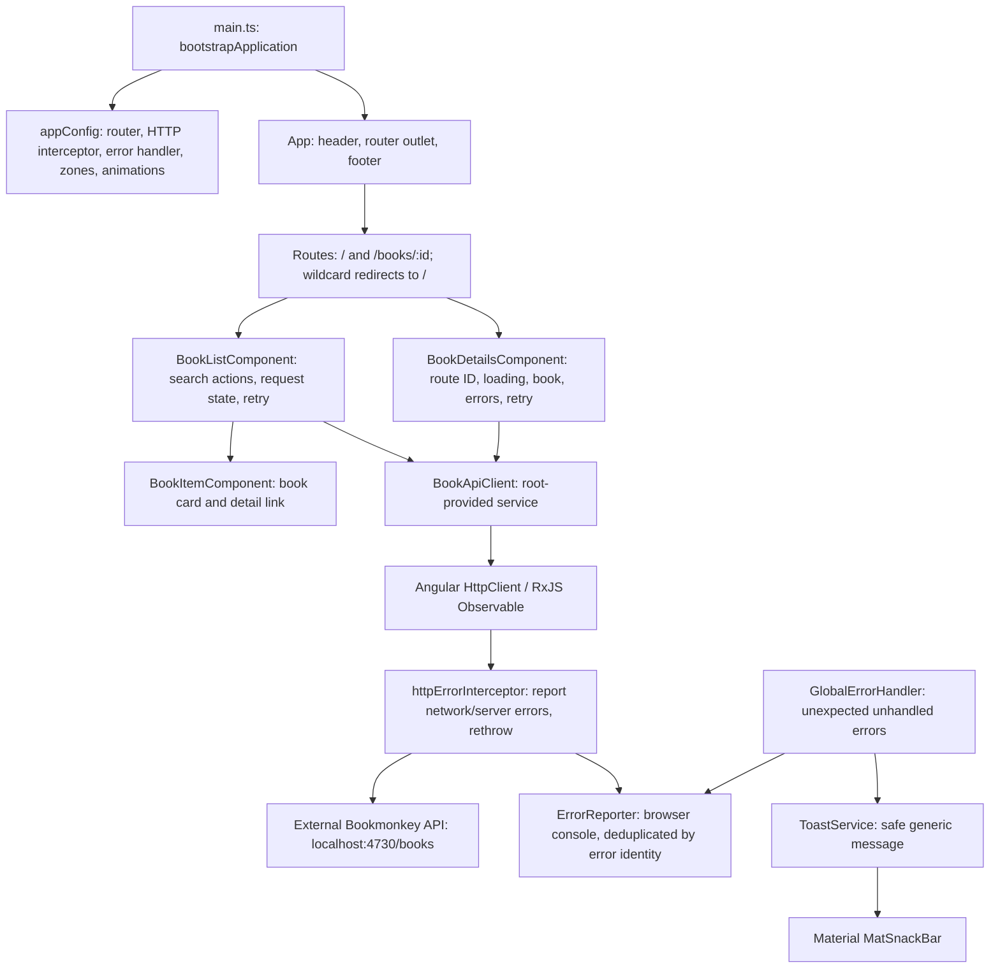

# Architecture

BookMonkey is a small Angular workshop application for browsing, searching, and viewing book details. It is a browser-rendered single-page application with list and detail views in one book feature, a separate HTTP API, and state owned by the feature components.

This document describes the current repository implementation after the refactoring on 2026-11-09. Source and configuration were inspected and the production build was executed. The verification section distinguishes current checks from historical book-details checks and behavior that remains untested. [REFACTORING.md](./REFACTORING.md) records the original findings and their implementation status.

## Application structure

The application uses standalone components and Angular dependency injection; there is no application `NgModule` or central store.



| Area                  | Source                                                                   | Responsibility                                                                                                                                                    |
| --------------------- | ------------------------------------------------------------------------ | ----------------------------------------------------------------------------------------------------------------------------------------------------------------- |
| Bootstrap             | [src/main.ts](./src/main.ts)                                             | Starts `App` with `bootstrapApplication`; logs bootstrap failures.                                                                                                |
| Application providers | [app.config.ts](./src/app/app.config.ts)                                 | Registers browser error listeners, custom error handling, zone-based change detection with event coalescing, routing, HTTP error reporting, and animations.       |
| Shell                 | [app.ts](./src/app/app.ts), [app.html](./src/app/app.html)               | Renders the shared header/footer and `RouterOutlet`.                                                                                                              |
| Routing               | [app.routes.ts](./src/app/app.routes.ts)                                 | Eagerly imports the list for `/` and details for `/books/:id`; redirects unmatched paths to the list. No lazy routes, guards, or resolvers are configured.        |
| Feature/controller    | [book-list.component.ts](./src/app/books/book-list.component.ts)         | Owns typed search actions and loading/success/error states; cancels superseded work and supports clear and retry.                                                 |
| Detail view           | [book-details.component.ts](./src/app/books/book-details.component.ts)   | Loads a book from the route ID, renders its details, and owns loading, not-found, error, retry, and cover-fallback behavior.                                      |
| Presentation          | [book-item.component.ts](./src/app/books/book-item.component.ts)         | Receives a `Book` input and displays its cover, title, optional subtitle, author, and ISBN inside a keyboard-accessible link to `/books/:id`. Makes no API calls. |
| API adapter           | [book-api-client.service.ts](./src/app/books/book-api-client.service.ts) | Encapsulates the API URL and query parameters; `getBooks` returns `Observable<Book[]>`, and `getBook(id)` returns `Observable<Book>` with a URL-encoded ID.       |
| Data contract         | [book.ts](./src/app/books/book.ts)                                       | Defines the TypeScript interface shared by the API client and components.                                                                                         |
| Shared utility        | [toast.service.ts](./src/app/shared/toast.service.ts)                    | Wraps Material snack bars; the global error handler uses a 6-second generic message for unexpected failures.                                                      |

The feature folder groups its UI, model, and API adapter together. The dependency direction is shell/router → feature component → API adapter → external API, with a separate presentation component below the feature component. This separation is visible in the imports; it is not enforced by a separate library or architectural lint rule.

## Data flow and state

### Book list

1. The template subscribes once to `state$` through `AsyncPipe`. Its initial action calls `getBooks` with a default `pageSize` of 10.
2. `BookApiClient` sends `GET http://localhost:4730/books?_limit=10`. A nonempty search adds the `q` query parameter through `HttpParams`.
3. Search, clear, and retry actions feed a single pipeline. Repeated search terms are suppressed; text changes wait 300 ms. The outer `switchMap` cancels any pending delay or active request immediately when a new action arrives, before starting the next delay or request.
4. Clear resets the input and loads the unfiltered list immediately. Retry immediately repeats the current term without being suppressed by term deduplication.
5. A discriminated view state exposes `loading`, `success` with books, or `error`. Successful zero results show an empty view. Failures remove previous cards and show an accessible local error view with retry; inner-stream error handling keeps later input and retries alive.
6. The external template tracks cards by `book.id`. Destroying the view unsubscribes through `AsyncPipe`, canceling both pending delays and active requests.

The search input uses template-driven forms (`ngModel`). Search state is not synchronized with the URL or persisted when returning from details. `_limit` restricts the requested result count; no page navigation or offset is implemented.

### Book details

1. Each book card links to `/books/:id`. The detail component reads `ActivatedRoute.paramMap`, so direct navigation and reloads do not depend on an already loaded list.
2. The route ID and retry trigger are combined into `state$`. `switchMap` starts `BookApiClient.getBook(id)`, which sends `GET http://localhost:4730/books/{encodedId}`. Changing the ID cancels the previous request. The template's `AsyncPipe` owns the subscription and unsubscribes when the view is destroyed.
3. Each request starts with a loading state. Success provides the book; HTTP 404 produces a distinct not-found state; other failures produce an error state with a retry button. Errors are handled inside the request stream so retry and subsequent route changes remain available. A discriminated union makes these request states mutually exclusive in the type as well as in emitted values.
4. The view displays title, optional subtitle, author, ISBN, publisher, page count, price, cover, and description. Price remains the API string; the description is interpolated as text. Empty additional fields are hidden, and a missing or failed cover image produces a placeholder. `coverFailed` is local UI state reset for each request. A keyboard-accessible link returns to the list.

There is no central store, query cache, or browser persistence. Both views own typed RxJS request-state streams consumed once with `AsyncPipe`. The search term and cover failure flag remain local UI fields.

### Logic and templates

The list, details, and card use colocated external HTML templates with built-in `@if`, `@for`, and `@switch` control flow as needed. Components own user actions and request state, the API adapter owns transport, and the card stays presentational. Templates select views and bind values; descriptions remain plain text. No shared state framework or extra dependency was introduced.

- [List template](./src/app/books/book-list.component.html)
- [Detail template](./src/app/books/book-details.component.html)
- [Card template](./src/app/books/book-item.component.html)

### Error handling and reporting

[httpErrorInterceptor](./src/app/shared/http-error.interceptor.ts), registered with `withInterceptors`, reports HTTP network failures (status 0) and server failures (status 500 and above) to [ErrorReporter](./src/app/shared/error-reporter.service.ts). It rethrows the original error without retrying or showing notifications. Feature components retain responsibility for expected failures, not-found views, and recovery.

[GlobalErrorHandler](./src/app/shared/global-error-handler.ts) is registered as the application's root `ErrorHandler` alongside the existing browser global error listeners. It reports unexpected unhandled failures and lazily resolves [ToastService](./src/app/shared/toast.service.ts) to display a generic reload message within Angular's zone. Exception details remain in diagnostics. Notification failures are caught and reported rather than propagated through the handler again.

The workshop reporting destination is the browser console. Reports include their source; HTTP reports add method, endpoint URL without query parameters, and status. The reporter deduplicates object errors by identity with a `WeakSet`, including errors reported by more than one layer. The global handler independently deduplicates notifications for the same error object. There is no remote telemetry or persisted report store. Expected HTTP errors produce local UI feedback without a duplicate global toast; 4xx failures are not reported by the interceptor. Bootstrap failures still use the catch handler in [main.ts](./src/main.ts).

### Data contract

The [Book interface](./src/app/books/book.ts) includes `id`, `isbn`, `title`, optional `subtitle`, `author`, `publisher`, `numPages`, `price`, `cover`, `abstract`, and `userId`. `price` is a string. The detail page uses this existing model without adding publication date or genre. The client requests this interface directly, with no DTO mapping or runtime response validation. A real response from Bookmonkey API 3.3.0 was inspected and used in the browser smoke check; this is not exhaustive schema validation. Search semantics remain untested against the real API.

## Technology stack and dependencies

The tables cover all direct dependencies in [package.json](./package.json). Versions are the declared constraints; exact resolutions are recorded in [package-lock.json](./package-lock.json). A package's presence in the manifest does not imply that the current application uses its features.

### Application dependencies

| Package(s)                                                                           | Declared version | Role in this repository                                                                                                                                 |
| ------------------------------------------------------------------------------------ | ---------------- | ------------------------------------------------------------------------------------------------------------------------------------------------------- |
| `@angular/core`, `@angular/common`, `@angular/compiler`, `@angular/platform-browser` | `20.2.1` each    | Angular components, dependency injection, template support, compilation support, browser bootstrap, and HTTP support via `@angular/common/http`.        |
| `@angular/router`                                                                    | `20.2.1`         | List/detail routing, book-card links, route parameters, and the shell's router outlet.                                                                  |
| `@angular/forms`                                                                     | `20.2.1`         | Template-driven search input through `FormsModule` and `ngModel`.                                                                                       |
| `@angular/animations`                                                                | `20.2.1`         | Animation support is enabled by `provideAnimations`.                                                                                                    |
| `@angular/material`                                                                  | `^20.2.0`        | Used by global-error snack-bar feedback and global snack-bar Sass overrides; locked to `20.2.0` in the inspected lockfile.                              |
| `@angular/cdk`                                                                       | `20.2.0`         | Declared UI infrastructure dependency alongside Material; no direct CDK imports in application source.                                                  |
| `rxjs`                                                                               | `7.8.0`          | HTTP observables, cancellable search/debounce and retry pipelines, typed view-state streams consumed by `AsyncPipe`, and interceptor error propagation. |
| `zone.js`                                                                            | `0.15.0`         | Configured browser polyfill, paired with zone-based change detection.                                                                                   |
| `tslib`                                                                              | `2.3.0`          | TypeScript runtime helper dependency; `importHelpers` is enabled in the TypeScript configuration.                                                       |
| `@ngrx/signals`                                                                      | `20.0.1`         | Declared but not imported or configured in application source.                                                                                          |
| `@angular-architects/ngrx-toolkit`                                                   | `^20.1.0`        | Declared but not imported or configured; inspected lockfile resolves `20.1.0`.                                                                          |
| `@tanstack/angular-query-experimental`                                               | `^5.85.5`        | Declared but no query provider or queries are configured; inspected lockfile resolves `5.85.5`.                                                         |
| `@angular/platform-server`, `@angular/ssr`                                           | `20.2.1` each    | Declared, but there is no server bootstrap, server build entry, hydration provider, or SSR configuration.                                               |
| `express`                                                                            | `5.1.0`          | Declared, but no Express server is implemented in this repository. It is not the implementation of the separately launched Bookmonkey API here.         |

### Development dependencies

| Package(s)                            | Declared version | Role in this repository                                                                                                                         |
| ------------------------------------- | ---------------- | ----------------------------------------------------------------------------------------------------------------------------------------------- |
| `typescript`                          | `5.9.2`          | Strict TypeScript compilation targeting ES2022 with module preservation. Angular strict template and injection checks are enabled.              |
| `@angular/cli`, `@angular/build`      | `20.2.0` each    | CLI, application builds, development server, and configured test builder.                                                                       |
| `@angular/compiler-cli`               | `20.2.1`         | Angular compilation tooling.                                                                                                                    |
| `tailwindcss`, `@tailwindcss/postcss` | `4.1.12` each    | Utility styling, imported by the global stylesheet and processed through PostCSS.                                                               |
| `postcss`                             | `8.5.6`          | CSS processing configured in [.postcssrc.json](./.postcssrc.json).                                                                              |
| `@playwright/test`                    | `^1.55.0`        | Browser-test tooling; inspected lockfile resolves `1.55.0`. Book-detail tests use controlled API responses; external-site examples also remain. |
| `prettier`                            | `3.6.2`          | Formatting governed by [.prettierrc](./.prettierrc). The package formatting script targets source files only.                                   |
| `@types/node`                         | `^20.17.19`      | Node type definitions; inspected lockfile resolves `20.19.11`. This is not a declared Node runtime requirement.                                 |
| `@types/express`                      | `^5.0.1`         | Express type definitions; inspected lockfile resolves `5.0.3`. No application server source currently uses them.                                |

No Node engine constraint or package-manager version is declared in the package manifest. The implementation checks below ran with Node.js 24.22.1 and npm 11.9.0; compatibility across other runtime versions was not assessed.

## Styling and browser resources

Most visual styling is implemented with Tailwind utility classes in component templates. [src/styles.css](./src/styles.css) imports Tailwind, and [src/material-theme.scss](./src/material-theme.scss) adds a Material snack-bar color override. Both are global build styles in [angular.json](./angular.json); the shell's own [app.css](./src/app/app.css) is empty.

[src/index.html](./src/index.html) links to Google-hosted Roboto and Material Icons stylesheets. Book cover images use URLs supplied in API data. These introduce browser-side resource requests beyond the app and API. Files in [public](./public) are copied as build assets.

## External API and deployment boundary

The [README](./README.md) documents `npx bookmonkey-api` as a separately launched fake-data API on port 4730. It is not declared as a dependency of this project, and its implementation and persistence are outside this repository. `npm start` starts the Angular development server only.

The API URL is hard-coded in [BookApiClient](./src/app/books/book-api-client.service.ts). No environment-specific endpoint configuration, development proxy, or authentication is configured. The HTTP interceptor reports failures without changing the endpoint or adding authentication. When served from the configured local frontend URL (`http://localhost:4200`), requests to port 4730 cross origins. Cross-origin detail loading was tested successfully against an isolated instance of Bookmonkey API 3.3.0 using data held in memory. A separate real-API check verified that an existing ID returns HTTP 200 and an unknown ID returns HTTP 404. These checks establish behavior for that version and setup, not ongoing API availability or production configuration.

Architectural implication: deployment beyond the workshop environment requires an API address reachable from the user's browser; `localhost` in the current code refers to that user's machine. The existing repository provides a browser build configuration, not a configured production API or server deployment.

## Build and testing

[angular.json](./angular.json) defines one application project, `angular-workshop-modern`, using `@angular/build:application` with [src/main.ts](./src/main.ts) as its browser entry. Production is the default build configuration, with output hashing and budgets of 500 kB warning / 1 MB error for the initial bundle and 4 kB warning / 8 kB error for individual component styles. Development disables optimization and enables source maps.

| Command                                                                      | Configured purpose and limits                                                                                                                                                                                                                                                                |
| ---------------------------------------------------------------------------- | -------------------------------------------------------------------------------------------------------------------------------------------------------------------------------------------------------------------------------------------------------------------------------------------- |
| `npm install`                                                                | Installs project dependencies.                                                                                                                                                                                                                                                               |
| `npm start`                                                                  | Runs `ng serve` with the development configuration.                                                                                                                                                                                                                                          |
| `npx bookmonkey-api`                                                         | Launches the external fake-data API according to the README; its package version is not pinned here.                                                                                                                                                                                         |
| `npm run build`                                                              | Runs the default production Angular build.                                                                                                                                                                                                                                                   |
| `npm run watch`                                                              | Rebuilds with the development configuration as files change.                                                                                                                                                                                                                                 |
| `npm test`                                                                   | Runs `ng test`; the configured builder is `@angular/build:karma`. No `src/**/*.spec.ts` files exist, and Karma/Jasmine packages are not declared as direct dependencies, although [tsconfig.spec.json](./tsconfig.spec.json) requests Jasmine types. Test execution readiness is unverified. |
| `npx playwright test`                                                        | Uses [playwright.config.ts](./playwright.config.ts), starts/reuses the Angular dev server, and configures Chromium, Firefox, and WebKit projects. Includes BookMonkey detail tests and external `playwright.dev` examples.                                                                   |
| `npx playwright test tests/book-details.spec.ts --workers=3 --reporter=line` | Runs only the book-detail scenarios against controlled API responses in all three configured browsers. This was the executed feature-test command.                                                                                                                                           |
| `npm run format.write`                                                       | Formats supported files under `src`; it does not include root Markdown documentation.                                                                                                                                                                                                        |

The [book-detail tests](./tests/book-details.spec.ts) contain ten scenarios: keyboard navigation from the list and back; direct loading and reload with correct fields and plain-text description; loading state; HTTP 404; server-error retry; network failure; missing additional fields and cover; broken cover; narrow layout with long values; and cancellation when the route ID changes. Their 30 cases passed across Chromium, Firefox, and WebKit after the template/state refactor.

The [list tests](./tests/book-list.spec.ts) add fourteen scenarios for initial loading and links, debounce and latest results, immediate request cancellation, clear during debounce/request, cleanup on navigation, failure versus empty results, unchanged-term retry, network recovery, and new input after failure. The [global-error tests](./tests/global-errors.spec.ts) add six scenarios for browser errors, promise rejections, repeated-error deduplication, HTTP failure reporting with local retry, expected 404 handling, and network failure reporting without a global toast.

Run all three application test files together:

```sh
npx playwright test tests/book-details.spec.ts tests/book-list.spec.ts tests/global-errors.spec.ts --workers=3 --reporter=line
```

These tests use controlled API responses and do not establish real-API search behavior. Global browser-error events are dispatched by the tests to exercise the application's registered handlers; no application test hooks are added.

The additional [tests-examples](./tests-examples) directory contains an external TodoMVC example and is outside Playwright's configured `testDir`. The external example tests were not part of the targeted feature run. No lint script or CI workflow is present in the inspected repository files.

## Architectural constraints and extension points

The earlier list request-ordering, debounce cleanup, and error-presentation findings have been addressed with the action/state pipeline described above. Remaining boundaries include component-local state, a fixed API URL, and a console-only diagnostic destination.

Additional architecture boundaries:

- **State ownership:** state stays within the list and detail components. Shared state or request caching would require an explicit design choice; the declared NgRx and TanStack packages do not provide it automatically.
- **Feature growth:** further routes belong in [app.routes.ts](./src/app/app.routes.ts), API operations in [BookApiClient](./src/app/books/book-api-client.service.ts), card presentation in [BookItemComponent](./src/app/books/book-item.component.ts), and detail behavior in [BookDetailsComponent](./src/app/books/book-details.component.ts). Lazy loading, a store, or SSR would be additional architecture work.

## Verification status

- **Verified by inspection:** component/service boundaries, list/detail routing, providers, state/request code, direct dependency constraints and lockfile resolutions, build/style configuration, and the scope of feature and example tests. Source links above provide the evidence.
- **Current refactoring checks on 2026-11-09:** `npm run build` passed after the final global-handler change. The three-file application regression command above passed all 90 cases (30 scenarios across Chromium, Firefox, and WebKit), including search cancellation/cleanup, list errors and recovery, template/state regressions, global reporting, and notification deduplication. API responses were mocked; browser error/rejection events were dispatched by the tests.
- **Historical book-details implementation on 2026-11-09:** `npm run build` passed; the targeted Playwright command above passed 30 cases (ten scenarios in three browsers). Prettier checks for the changed source/test files and `git diff --check` passed.
- **Historical real API and visual checks during book-details implementation (not repeated for refactoring):** an isolated Bookmonkey API 3.3.0 instance returned HTTP 200 for an existing ID and HTTP 404 for an unknown ID. A Chromium smoke check loaded and reloaded a real book through the frontend without JavaScript page errors. Desktop and 375-pixel-wide mobile screenshots were visually inspected; the mobile page had no horizontal overflow. The API instances used in-memory data; persistent storage was not tested.
- **Not runtime-verified:** real-API search semantics, exhaustive response-schema compatibility, the Karma test command, the full suite including external examples, other API versions, and production hosting. The isolated checks do not establish continued availability of a separately running API.
- **Historical findings:** the earlier list request-ordering and lifecycle risks were source-derived before refactoring. Current regression checks are recorded separately above.
- **Unknown from this repository:** the intended production hosting environment and the configuration/persistence of any separately deployed API.
