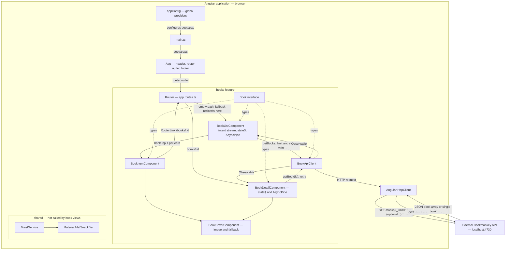

# Application architecture

BookMonkey is an Angular workshop application for browsing and searching a book catalog and viewing individual book details. It runs as a browser-rendered single-page application (SPA) and reads data from a separately started Bookmonkey API. This summary describes the implementation in this repository.

## Technology stack and dependencies

Versions below are the declarations in [package.json](package.json). Exact resolved versions, including transitive dependencies, are recorded in [package-lock.json](package-lock.json); declarations beginning with `^` allow compatible updates.

| Technology / packages                                    | Declared version          | Role in this application                                                                                                                                                       |
| -------------------------------------------------------- | ------------------------- | ------------------------------------------------------------------------------------------------------------------------------------------------------------------------------ |
| Angular core, common, compiler, platform-browser, router | 20.2.1                    | Standalone components, dependency injection, templates, browser bootstrap, routing, and HTTP access through `@angular/common/http`.                                            |
| Angular forms                                            | 20.2.1                    | Template-driven search input using `FormsModule` and `ngModel` value/event binding.                                                                                            |
| RxJS                                                     | 7.8.0                     | `Observable<Book[]>` for the catalog and `Observable<Book>` for details; route-driven detail state, retries, and request cancellation.                                         |
| Zone.js                                                  | 0.15.0                    | Zone-based change detection, configured with event coalescing. This app is not configured for zoneless change detection.                                                       |
| Angular Material / CDK / animations                      | ^20.2.0 / 20.2.0 / 20.2.1 | A shared toast service wraps Material's snack bar; animations are provided globally, and a Sass file customizes snack-bar colors. The catalog UI itself uses Tailwind classes. |
| Tailwind CSS / its PostCSS plugin                        | 4.1.12                    | Utility styling and responsive layouts; loaded through `src/styles.css` and `.postcssrc.json`.                                                                                 |
| PostCSS                                                  | 8.5.6                     | CSS processing used by the Tailwind integration.                                                                                                                               |
| TypeScript                                               | 5.9.2                     | Application language, with strict compiler checks and strict Angular template checking; JavaScript target is ES2022.                                                           |
| Angular CLI / build / compiler-cli                       | 20.2.0 / 20.2.0 / 20.2.1  | Development server, application build, and Angular compilation.                                                                                                                |
| Playwright Test                                          | ^1.55.0                   | Browser tooling for Chromium, Firefox, and WebKit; 27 application tests with intercepted API responses. External-site examples are outside discovery.                          |
| Karma / Jasmine                                          | ~6.4.0 / ~5.9.0           | Unit tests through the existing Angular Karma builder, with Jasmine types, Chrome launcher, and reporters declared as development dependencies.                                |
| Prettier                                                 | 3.6.2                     | Formatting configured in `.prettierrc`.                                                                                                                                        |
| tslib                                                    | 2.3.0                     | Runtime helpers for compiled TypeScript.                                                                                                                                       |

Additional dependencies are declared but are not wired into the current application:

- `@ngrx/signals` (20.0.1), `@angular-architects/ngrx-toolkit` (^20.1.0), and `@tanstack/angular-query-experimental` (^5.85.5): there is no signal store, toolkit integration, or query client in the source. State and requests are managed directly by the component and HTTP service.
- `@angular/platform-server` and `@angular/ssr` (20.2.1), plus Express (5.1.0): there is no server entry point or SSR configuration in `angular.json`. These declarations do not make the current application server-rendered or provide its book API.
- `@types/node` (^20.17.19) and `@types/express` (^5.0.1) provide development-time type definitions; their versions do not establish a required Node.js runtime version.

## Structure and responsibilities

The application is organized around a single `books` feature and shared presentation/diagnostic utilities. It uses standalone components rather than an application `NgModule`.

| Location                                    | Responsibility                                                                                                                                                     |
| ------------------------------------------- | ------------------------------------------------------------------------------------------------------------------------------------------------------------------ |
| `src/main.ts`                               | Bootstraps the root `App` with `bootstrapApplication(App, appConfig)`.                                                                                             |
| `src/app/app.config.ts`                     | Registers global error listeners, the root error handler, HTTP diagnostics, zone change detection, routes, and animations.                                         |
| `src/app/app.ts`, `app.html`, `app.css`     | Root shell: BookMonkey header, router outlet, and footer.                                                                                                          |
| `src/app/app.routes.ts`                     | Maps `/` to `BookListComponent` and `/books/:id` to `BookDetailComponent`; both are imported eagerly. The final wildcard redirects unmatched paths to the catalog. |
| `src/app/books/book-list.component.ts`      | Owns the catalog intent/state stream and request cancellation; adjacent HTML renders the view.                                                                     |
| `src/app/books/book-item.component.ts`      | Displays one book supplied through an `@Input()`: cover or fallback, title link to details, optional subtitle, author, and ISBN.                                   |
| `src/app/books/book-detail.component.ts`    | Owns route-driven detail loading, retry and error states, request state; its adjacent HTML template renders the responsive view.                                   |
| `src/app/books/book-api-client.service.ts`  | Root-provided HTTP adapter with `getBooks()` for catalog queries and `getBook(id)` for individual books; encodes the ID as a URL path segment.                     |
| `src/app/books/book.ts`                     | TypeScript `Book` interface shared by the service and components.                                                                                                  |
| `src/app/shared/toast.service.ts`           | Root-provided wrapper around `MatSnackBar`, with a default three-second duration. It is not called by the catalog or detail flows.                                 |
| `src/styles.css`, `src/material-theme.scss` | Global Tailwind import and Material snack-bar overrides.                                                                                                           |
| `public/`                                   | Static asset source copied by the Angular build.                                                                                                                   |
| `tests/`, `tests-examples/`                 | Application browser specs and shared `tests/support/` helpers; workshop/external-site examples are preserved outside discovery in `tests-examples/`.               |

The feature-local `src/app/books/book-cover.component.ts` renders cover images and fallbacks without fetching book data. The list, detail, and card layouts use adjacent HTML templates. `src/app/api-base-url.ts` defines the API origin token supplied by the root configuration.

`src/app/shared/request-error.component.ts` owns shared alert styling and the optional retry button. Features project their own headings/messages, preserve heading hierarchy, and handle retry events locally. `src/app/shared/error-reporting.ts` supplies a structured console sink, `AppErrorHandler`, and a functional HTTP interceptor registered in `app.config.ts`. The interceptor observes failures without changing their error channel: all HTTP failures except expected 404s report method/status once per failed request, without request URLs, query strings, or response bodies. Unsubscription does not report an error. The root handler reports unexpected runtime failures; `main.ts` reports bootstrap failures before dependency injection is available. There is no external reporting backend or automatic retry policy.

## Data flow and state

Solid arrows show bootstrap, rendering, service calls, and data flow; dotted arrows show compile-time type dependencies. The API runs separately from the Angular application.

### Catalog

1. `BookListComponent` seeds a `BehaviorSubject<CatalogIntent>` with an immediate initial load. Its single `AsyncPipe` subscription starts the request using the `pageSize` input, which defaults to 10.
2. `BookApiClient.getBooks()` sends `GET /books` with `_limit` and, when a search term is supplied, `q`. The API handles filtering; the browser does not filter a previously downloaded catalog.
3. The container emits typed loading, success (with books), or error state. `book-list.component.html` renders the state with built-in control flow and tracks cards by book ID. New intent immediately replaces old results with loading, including during debounce, so stale results are never displayed under a new query.
4. Search uses `ngModel` to update the intent subject. An outer `switchMap` immediately cancels the previous debounce or request. Nonempty input waits 300 ms using an RxJS timer before calling the API; unchanged input is ignored. Clearing through the button or deleting all text loads immediately and cancels any pending timer. The search term is derived from the current intent rather than stored separately.
5. HTTP errors become a visible alert with manual Retry, distinct from successful empty results. Request-local `catchError` keeps later searches and retries working. Retry repeats the current term immediately. `AsyncPipe` unsubscribes on destruction, canceling pending timers and HTTP work. There are no imperative component subscriptions or constructor effects.

### Book details

1. Each catalog title is a keyboard-operable `RouterLink` to `/books/:id` with a visible focus outline. The detail page also supports direct visits and refreshes; it does not use catalog data as a cache.
2. `BookDetailComponent` maps `ActivatedRoute.paramMap` to the ID and uses `distinctUntilChanged()` to avoid duplicate loads for the same route parameter. An outer `switchMap` replaces the detail flow when the ID changes, including when Angular reuses the component.
3. A local `Subject<void>` triggers retries. `startWith(undefined)` initiates the first request for each ID; an inner `switchMap` calls `BookApiClient.getBook(id)` and cancels an obsolete request on retry.
4. `state$` emits a typed `BookDetailState`: `loading`, `success` with the book, `not-found` for HTTP 404, or `error` for other failures. Every request starts with `loading`, removing previously displayed details. `catchError` is inside the request stream, so errors do not prevent subsequent retries or route changes.
5. The template subscribes once through `AsyncPipe`, which unsubscribes on component destruction and thereby cancels active HTTP work. `@if` and `@switch` render the states. Loading uses `role="status"`; error states use `role="alert"`. Other failures offer a Retry button, while 404 displays “Book not found”.
6. A feature-local `BookCoverComponent` owns image-load failure state for both cards and details. It resets on input changes; the detail loading branch destroys the old cover view between requests. Missing or broken covers show a fallback. The detail template lives in `book-detail.component.html`, while its container owns route and retry orchestration. The page displays title, optional subtitle, author, ISBN, publisher, page count, price, and abstract. It preserves the API price string and uses a `textContent` binding plus `whitespace-pre-wrap` for plain-text abstracts with paragraph breaks. It does not display `userId`.
7. “Back to books” links to `/` in every state, including on direct visits. The catalog is loaded anew on return; its previous search is not persisted. The detail layout adapts from a single column to cover and text columns on wider screens.

### Shared model and state boundaries

The `Book` model contains identity, ISBN, title/subtitle, author, publisher, page count, price, cover URL, abstract, and user ID. It is a compile-time interface; the HTTP response is not validated at runtime. Cover URLs come from the API and are bound directly to image elements.

There is no global state store, persistent browser state, request cache, authentication, or write operation in the current implementation. The limit controls result count rather than implementing page navigation. Both catalog and detail flows use cancellation and explicit request state; view destruction ends their subscriptions and pending work.

## Backend and runtime boundaries

The frontend's API origin is supplied through the `API_BASE_URL` injection token in `src/app/api-base-url.ts`. Its provider in `app.config.ts` defaults to `http://localhost:4730`; `BookApiClient` normalizes a trailing slash and appends `/books`. Configure that provider for another backend. There is no runtime environment loader or development proxy. The backend is an external workshop tool started with `npx bookmonkey-api`, not a server implemented in this repository or a declared project dependency. Its endpoint documentation is available at `http://localhost:4730` while it is running. During feature verification on 2026-11-09, a real `GET /books/:id` request returned the corresponding book and the fields used by the detail view. This confirms basic retrieval against the running instance, not a versioned API contract.

During local development the Angular server normally runs at `http://localhost:4200`. Browser requests go directly to the API on port 4730, so the API must permit that cross-origin access. Deploying the frontend elsewhere requires changing the API configuration: `localhost` refers to the machine running the browser.

Direct requests to `/books/:id` require the hosting server to serve the SPA entry point. The Angular development server supports this; production hosting must configure the same fallback.

`src/index.html` also loads Roboto and Material Icons stylesheets from Google Fonts. Book covers may introduce further external image requests according to the URLs returned by the API. The production build also fetches Google Fonts for inlining and therefore needs network access unless those resources are cached.

## Build, development, and verification

[angular.json](angular.json) defines one application, `angular-workshop-modern`, using the `@angular/build:application` builder. The global style entries include both Tailwind CSS and the Material Sass overrides. Production builds enable output hashing and enforce initial-bundle budgets of 500 kB for warnings and 1 MB for errors; individual component styles have 4 kB / 8 kB budgets. Development builds disable optimization and enable source maps.

| Command                                                             | Purpose / current configuration                                                                                                                 |
| ------------------------------------------------------------------- | ----------------------------------------------------------------------------------------------------------------------------------------------- |
| `npm install`                                                       | Install project dependencies.                                                                                                                   |
| `npm start`                                                         | Run `ng serve` with the development configuration. Start the API separately for catalog data.                                                   |
| `npx bookmonkey-api`                                                | Start the external fake-data API on port 4730.                                                                                                  |
| `npm run build`                                                     | Build the application with the default production configuration.                                                                                |
| `npm run watch`                                                     | Rebuild on changes using the development configuration.                                                                                         |
| `npm test`                                                          | Run all 13 Jasmine unit tests once in Chrome Headless. Install Chrome or set `CHROME_BIN`. `npm run test:watch` enables interactive watch mode. |
| `npm run test:e2e`                                                  | Run all application browser tests in Chromium; `npm run test:e2e:all` runs all configured browsers.                                             |
| `npm run typecheck`                                                 | Type-check application, unit tests, and browser tests/configuration.                                                                            |
| `npm run format:check`                                              | Check formatting across source, tests, configuration, and documentation.                                                                        |
| `npx playwright test`                                               | Run application specs under `tests/` in Chromium, Firefox, and WebKit. Starts or reuses the Angular dev server; API responses are intercepted.  |
| `npx playwright test tests/book-details.spec.ts --project=chromium` | Run the 16 book-feature tests against the local app with intercepted API responses; no external Bookmonkey API is needed.                       |
| `npx playwright install chromium`                                   | Install the browser required for the focused Chromium tests if it is not already cached.                                                        |
| `npm run format.write`                                              | Format matching TypeScript, HTML, Markdown, CSS, and JSON files under `src/`. Root-level documentation is outside this script's scope.          |

The larger TodoMVC example in `tests-examples/` is outside Playwright's configured test directory. The 16 tests in `tests/book-details.spec.ts` cover keyboard navigation from the catalog, detail fields and plain-text abstracts, direct visits and refreshes, loading, 404, retry after failure, missing/broken covers and absent subtitles at a mobile viewport, return navigation, cancellation during ID changes, recovery after route errors, and encoding IDs as a single API path segment. API, test cover images, and Google Fonts CSS responses are intercepted. The tests also cover card fallback for absent/broken covers, cover recovery after a catalog reload, and a new detail request reattempting the same previously failed cover URL. The nine tests in `tests/book-catalog.spec.ts` additionally cover debounce timing, search races, clearing during debounce, error recovery, empty results, and navigation cleanup. Run both spec files for the complete application suite.

## Architectural assessment

The current design is proportionate to a single-feature workshop application. Catalog request races and error presentation have been addressed with a lifecycle-bound stream and focused browser tests. Unit-test tooling now runs, shared errors have one presentation pattern, and diagnostics have a console destination. Remaining product risks include deployment configuration, unused dependency surface, and the unversioned external API contract. The assessment below includes the resolved findings and remaining recommendations.

### Boundaries and dependency direction

- The style is a feature-organized, component-driven SPA with a thin HTTP service layer. There is no substantive domain layer: `Book` is a shared transport and presentation contract.
- The list/item split follows the container/presentational pattern: the list owns effects and state; cards render inputs and expose navigation links. The sibling detail container owns its own requests and view state. Keep this distinction when adding interactions.
- Dependency direction is shell/router → feature container → API client → Angular HTTP, with the container also depending on the card component. No circular dependencies were found in the inspected application imports.
- Angular dependency injection makes services replaceable in tests, although the list depends on the concrete `BookApiClient` rather than a domain-facing interface. That coupling is acceptable at the current scale; additional repository interfaces need a concrete justification.
- Feature boundaries are directory conventions. No architectural lint rules or package boundaries enforce them. With only one feature, cross-feature isolation has not yet been demonstrated.
- Both root-provided services are currently stateless adapters. Their singleton lifetime does not imply a global mutable application store.

### Risk profile

Ratings assess the consequences of extending this code into a maintained application, not the suitability of the workshop exercises.

| Topic                        | Risk     | Evidence and implication                                                                                                                                                      |
| ---------------------------- | -------- | ----------------------------------------------------------------------------------------------------------------------------------------------------------------------------- |
| Modularity                   | Low      | The `books` folder is cohesive and `shared` has a narrow responsibility. Boundaries are conventional rather than enforced.                                                    |
| Dependency management        | Moderate | Imports are simple and acyclic, but UI and HTTP share the same model. Several unused architectural dependencies increase upgrade and maintenance scope.                       |
| State management             | Low      | Catalog and detail use lifecycle-bound request state and cancellation. New catalog intent cancels obsolete work before debounce completes.                                    |
| Feature scalability          | Moderate | Sibling features can reuse the container/presentation convention. Catalog and detail use request-local recovery; deployments must supply the API origin.                      |
| Testability and verification | Moderate | 13 unit tests and 27 Chromium application tests pass. Firefox and WebKit remain unverified.                                                                                   |
| Build and tooling            | Moderate | Conventional Angular tooling and strict compilation limit complexity. Incomplete test configuration, mismatched styles, and unused dependencies indicate configuration drift. |

### Known failure modes and hidden coupling

| Finding                               | Risk / category                                  | Concrete consequence                                                                                                        | Recommended correction                                                                                                                                                  |
| ------------------------------------- | ------------------------------------------------ | --------------------------------------------------------------------------------------------------------------------------- | ----------------------------------------------------------------------------------------------------------------------------------------------------------------------- |
| Out-of-order search responses         | Resolved                                         | New intent cancels the previous request immediately; a late obsolete response cannot replace current state.                 | Preserve cancellation coverage when changing orchestration.                                                                                                             |
| Pending debounce survives clearing    | Resolved                                         | Both clear paths replace the intent and load immediately, canceling the previous timer.                                     | Preserve tests asserting one unfiltered request after clearing during debounce.                                                                                         |
| Effects survive component destruction | Resolved                                         | AsyncPipe teardown cancels the active timer or request. Both cases have browser coverage.                                   | Keep one lifecycle-bound subscription and avoid independent effects.                                                                                                    |
| Errors resemble valid results         | Resolved                                         | Catalog errors render a distinct alert and Retry action; empty results are success state. New intent removes stale results. | Keep catchError inside the request stream so later searches and retries work.                                                                                           |
| Development API default               | High for deployment — structural, organizational | A deployed browser contacts its own machine at `localhost:4730`.                                                            | The API origin is now injected at the composition boundary. Supply a deployment-specific provider; use a relative endpoint where deployment infrastructure supports it. |
| Transport and UI share `Book`         | Moderate — structural, maintainability           | Backend shape changes propagate directly to presentation. Generic HTTP typing does not validate responses.                  | Add mapping or runtime validation at the client boundary when API variability or consumer requirements justify it.                                                      |
| External API version is unpinned      | Moderate — organizational                        | `npx bookmonkey-api` does not specify the supported tool version, and the API contract is outside this repository.          | Pin the supported version in the development setup and verify response shape, search semantics, and `_limit` against it.                                                |

### Architectural inconsistencies and tooling gaps

- **Inactive architectural options — Moderate risk:** NgRx, its toolkit, TanStack Query, and the SSR/Express packages are declared without corresponding application integration. These may support later workshop exercises, but that intent is inferred. Remove them from a maintained baseline or document the exercise that activates each. Their presence does not indicate multiple active state-management approaches.
- **Shared reporting policy:** expected request recovery stays in feature streams; the HTTP interceptor and root error handler use one console diagnostic sink. Expected 404s and cancellations do not create duplicate diagnostics; no automatic error toasts are shown.
- **Test scaffold repaired:** Karma/Jasmine development dependencies and 13 focused unit tests are present. Application browser specs share mocks/navigation helpers; external-site examples are outside discovery.
- **Style configuration aligned:** application and unit-test targets both load `src/styles.css` and `src/material-theme.scss`.
- **Toolchain reproducibility — Moderate risk:** the manifest declares no Node runtime requirement or package-manager version. A lockfile records resolved dependencies, but no repository CI workflow was found to enforce install, compilation, or application checks.

There is little excessive indirection or duplicated application logic today. The strongest over-engineering signal is the unused dependency surface. The list component is a likely future concentration point for behavior, but it is not currently large enough to justify describing it as a god component. A global store, framework-independent domain layer, or micro-frontend split is not justified by the inspected requirements.

### Verification evidence

Evidence from the architectural review and subsequent book-details implementation on 2026-11-09:

- `node node_modules/typescript/bin/tsc --project tsconfig.app.json --noEmit` passed. This checks TypeScript and does not establish a successful Angular production build or browser behavior.
- `node node_modules/typescript/bin/tsc --project tsconfig.spec.json --noEmit` failed with `TS2688: Cannot find type definition file for 'jasmine'`.
- Source inspection found no application unit specs. The new detail browser tests complement the existing external-site examples.

- `npm run build` passed after allowing network access for Google Fonts inlining. The initial bundle was 398.40 kB, below the 500 kB warning budget.
- `npx playwright test tests/book-details.spec.ts --project=chromium` passed all nine tests after installing the missing Chromium browser. Firefox and WebKit were not run.
- Prettier checks on the changed implementation/test files and `git diff --check` passed.
- A real `GET /books/:id` request to the running API returned the requested book with the expected detail fields. Error states and cancellation were verified using intercepted responses, not real backend failures.

The external API implementation and broader version compatibility were not inspected. The unit-test scaffold was incomplete at that stage; the project-wide verification below records its repair. These earlier results describe the original feature implementation.

### Evolution priorities

1. **Preserve request orchestration guarantees.** The catalog now has lifecycle-bound cancellation and dedicated race, debounce, and recovery coverage. Keep these tests when extending pagination or search.
2. **Extend browser verification deliberately.** The unit scaffold and application-only browser discovery now work. Run Firefox/WebKit before claiming coverage for those engines and keep helpers focused on application behavior.
3. **Complete deployment setup.** Supply the injected API origin for the deployment and pin the supported development API version.
4. **Reduce inactive options and establish conventions.** Retain only required dependencies, record the default server-state/error approach for new features, and define cross-feature import rules when a second feature is introduced.

The folder structure can support three similarly sized features and more parallel contributors without a structural rewrite. Team size and ownership practices are unknown, so this is a conditional assessment. Entropy may accumulate first in feature containers, competing state-library choices, shared business logic, and root provider configuration. Deployment configuration and API-contract ownership remain constraints to address.

### Project-wide refactoring and verification (2026-11-10)

The shared error view, central console diagnostics, external card template, browser-test helpers, and working unit-test setup extend the earlier feature refactoring across the project. The default browser suite now contains only application tests; both external-site workshop examples live in `tests-examples/`. `npm test` runs Jasmine/Karma once in Chrome Headless; `npm run test:watch` retains interactive watch mode. Chrome must be installed or supplied through `CHROME_BIN`. Application and unit-test builds use the same global style entries. `tsconfig.spec.json` discovers unit specs; `tsconfig.e2e.json` checks browser tests and Playwright configuration. `npm run typecheck` checks all three TypeScript projects.

Verified: 13 unit tests passed in Chrome Headless, 27 application tests passed in Chromium, all TypeScript projects passed, and the production build passed with Google Fonts access (383.80 kB initial bundle). Browser execution required permission outside the restricted sandbox. Firefox and WebKit were not run. The unit tests cover alternate API configuration, URL/parameter contracts, unchanged error propagation, reporting without duplicate 404/cancellation noise, cover input reset, and projected error headings/retry actions. Browser integration additionally verifies the shell wildcard route and the configured interceptor's single diagnostic with successful local recovery.

The error-handling boundaries follow the [Angular 20 error guidance](https://v20.angular.dev/best-practices/error-handling) and [functional interceptor guidance](https://v20.angular.dev/guide/http/interceptors). The existing [Angular 20 Karma/Jasmine test setup](https://v20.angular.dev/guide/testing) was repaired without changing application frameworks.

### Feature refactoring verification (2026-11-09)

The detail-feature refactoring extracted the HTML template and shared cover presentation, made the card input required, and injected the API origin. All 16 focused Chromium tests passed at that stage; the production build had a 386.44 kB initial bundle.

The subsequent catalog refactoring added one intent/state stream, immediate cancellation, explicit error recovery, and an external HTML template. All 25 focused Chromium tests passed (16 detail/card tests and nine catalog tests). Catalog coverage uses controlled HTTP responses and a paused browser clock, advancing animation frames after response completion to accommodate Angular's event-coalesced change detection. It covers debounce timing, latest-intent cancellation, late obsolete responses, both clear paths, initial and search failures, retry, subsequent search, empty results, and timer/request cleanup on navigation. The production build passed after allowing Google Fonts access, with a 381.13 kB initial bundle. Firefox and WebKit were not run. See [REFACTORING.md](REFACTORING.md) for implementation status and deferred reporting work.
