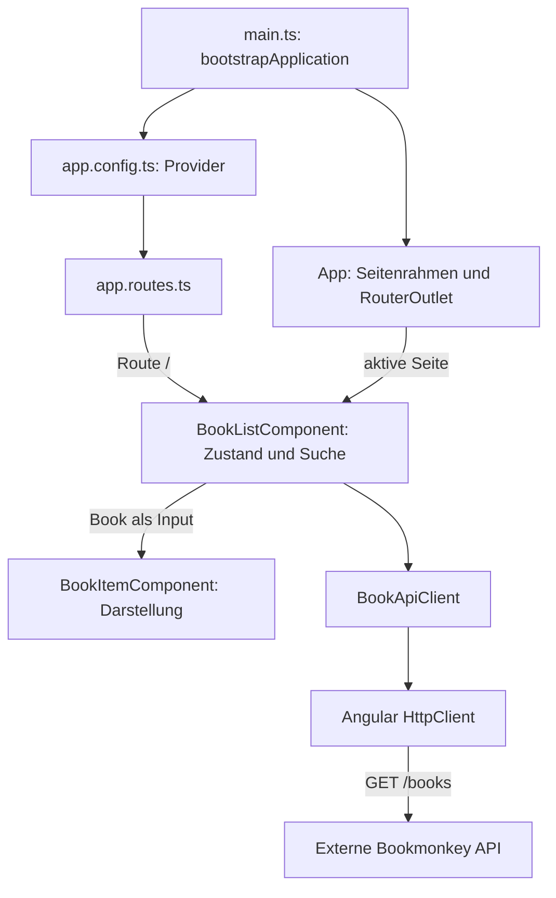

# Architekturreview: BookMonkey

[Zurück zur README](./README.md)

Stand: 9. November 2026. Grundlage ist der aktuelle Repository-Code einschließlich Konfiguration und Beispieltests.
Das Review beschreibt die implementierte Architektur; installierte Bibliotheken gelten nicht als implementierte Architekturentscheidungen.
Es ist eine statische Codeanalyse. Build, Browserabläufe und API-Verhalten wurden für dieses Review nicht ausgeführt.

## Kurzbewertung und Maßstab

Die kleine Workshop-Anwendung besitzt eine zweckmäßige Feature-Struktur und eine nachvollziehbare Trennung von Listenlogik, Buchdarstellung und HTTP-Zugriff.
Die größten Risiken betreffen die asynchrone Suche, fehlende sichtbare Fehlerzustände und die fehlende projektspezifische Testabsicherung.
Zusätzliche Domain-Schichten, ein globaler Store oder Micro-Frontends sind durch den aktuellen Umfang nicht begründet.

| Risikostufe | Bedeutung in diesem Review |
| --- | --- |
| **Low** | Im aktuellen Umfang tragfähig; höchstens lokale Bereinigung erforderlich. |
| **Moderate** | Konkrete Schwäche oder absehbares Wachstumshemmnis mit begrenztem Wirkungsbereich. |
| **High** | Bereits erkennbares Korrektheitsproblem oder wesentliche fehlende Absicherung vor einer Produktivnutzung. |

Risiken beziehen sich auf eine Weiterentwicklung zur produktiv betriebenen Anwendung. Für ein zeitlich begrenztes Workshop-Beispiel ist mehr davon tolerierbar.
Die historische Absicht einzelner Muster ist nicht dokumentiert; entsprechende Erklärungen sind ausdrücklich Hypothesen.

## 1. Architekturüberblick

### Stil und Grenzen

- **Stil:** komponentenbasierte Single-Page Application mit einem Feature-Ordner und einer dünnen HTTP-Service-Schicht.
- **Framework:** Angular 20 mit Standalone-Komponenten, TypeScript und Zone-basierter Änderungserkennung.
- **Feature-Grenze:** `src/app/books/` bündelt Datenmodell, API-Zugriff, Listenansicht und Buchkarte.
- **Anwendungsrahmen:** `App` stellt Header, Footer und `RouterOutlet` bereit; `app.config.ts` verdrahtet globale Provider.
- **Technische Querschnittsfunktion:** `shared/` enthält ausschließlich den derzeit ungenutzten `ToastService`.
- **Externe Grenze:** Die Bookmonkey API läuft separat. Backend-Implementierung und Datenhaltung gehören nicht zu diesem Repository.
- Es gibt keine eigenständige Domain-Schicht, keine Micro-Frontends und keine belegte Domain-driven-Design-Struktur.

### Einstiegspunkte und Verantwortlichkeiten

| Datei | Architekturrolle |
| --- | --- |
| [`src/main.ts`](./src/main.ts) | Startet `App` mit `appConfig`. |
| [`src/app/app.config.ts`](./src/app/app.config.ts) | Registriert HTTP, Router, Animationen, Fehlerlistener und Zone-Konfiguration. |
| [`src/app/app.ts`](./src/app/app.ts), [`app.html`](./src/app/app.html) | Anwendungsrahmen ohne Bücherlogik. |
| [`src/app/app.routes.ts`](./src/app/app.routes.ts) | `/` zeigt die direkt importierte Liste; unbekannte Pfade werden dorthin umgeleitet. |
| [`src/app/books/book-list.component.ts`](./src/app/books/book-list.component.ts) | Seitenzustand, Such-Timer, HTTP-Abonnements und Listen-Template. |
| [`src/app/books/book-item.component.ts`](./src/app/books/book-item.component.ts) | Darstellung eines Buchs ohne eigenen Datenabruf. |
| [`src/app/books/book-api-client.service.ts`](./src/app/books/book-api-client.service.ts) | HTTP-Transport und Übersetzung der Abrufparameter. |
| [`src/app/books/book.ts`](./src/app/books/book.ts) | Gemeinsamer Datenvertrag für API-Service und UI. |
| [`src/app/shared/toast.service.ts`](./src/app/shared/toast.service.ts) | Root-Service als Wrapper um `MatSnackBar`, bislang ohne Aufrufer. |

### Abhängigkeitsrichtung und Kopplung

- Die Richtung lautet `Routing → Listenkomponente → API-Service → HttpClient`; die Buchkarte hängt nur vom Modell und Angular-Imports ab.
- Das Feature importiert weder den App-Rahmen noch andere Features. Unter den untersuchten lokalen Imports sind keine Zyklen erkennbar.
- Dependency Injection liefert den konkreten `BookApiClient`. Ein separater Port oder Repository-Vertrag ist nicht vorhanden.
- Die UI hängt dadurch direkt vom HTTP-nahen Service und vom API-förmigen Modell ab. Für einen lesenden Einzelfall bleibt das überschaubar.
- `Book` ist ein TypeScript-Interface ohne Laufzeitvalidierung oder Mapping. Änderungen am API-Vertrag können bis in die Templates durchschlagen.
- Root-Services sind anwendungsweit verfügbar; der API-Service hält jedoch keinen gemeinsam veränderlichen Bücherzustand.

### Zustand, Datenfluss und Seiteneffekte

1. `ngOnInit()` startet `loadBooks()`; `pageSize` ist standardmäßig `10` und wird durch die Route nicht überschrieben.
2. `loadBooks()` setzt `loading` und abonniert `getBooks(pageSize, search)`.
3. Der Service sendet `GET http://localhost:4730/books?_limit=10`, bei Suchtext zusätzlich `q`.
4. Die Antwort ersetzt `books`; `loading` wird beendet. `trackById()` ordnet Karten anhand der Buch-ID zu.
5. `ngModel` schreibt Suchtexte in `searchTerm`; ein Timer verzögert den nächsten Abruf um 300 ms.
6. `clearSearch()` leert den Suchtext und lädt sofort erneut, ohne einen ausstehenden Timer zu löschen.

Der gesamte Seitenzustand liegt in veränderlichen Komponentenfeldern. Es gibt weder einen zentralen Store noch Query-Caching oder lokale Persistenz.
HTTP, Timer und Konsolenlogging sind die Seiteneffekte. HTTP ist im Service gekapselt; Lebenszyklus und Antwortreihenfolge steuert die Komponente nicht vollständig.
Die Karte empfängt Daten von oben. Eine Verletzung durch Rückmutation des übergebenen Buchs ist im aktuellen Code nicht erkennbar.

### Laufzeit und Annahmen

- `npm install` installiert Projektabhängigkeiten; `npm start` startet Angular üblicherweise unter `http://localhost:4200`.
- `npx bookmonkey-api` startet laut README die externe API unter `http://localhost:4730`; sie ist keine deklarierte Projektabhängigkeit.
- Der Browser ruft die API direkt auf. Bei verschiedenen Origins ist eine passende CORS-Freigabe der API erforderlich.
- Die genaue Semantik von `q`, API-Fehlermodell und Datenpersistenz sind hier nicht implementiert oder verifiziert.
- Es existieren nur Lesen und Suche. `_limit` ist eine Ergebnisbegrenzung; Paging, Detailansicht, Schreiben und Authentifizierung fehlen.

## 2. Kritische Architekturthemen

### A. Modularität — **Low**

- `books/` ist kohäsiv: Alle Dateien dienen derselben Funktion; `shared/` enthält keine fachlichen Bücherabhängigkeiten.
- Grenzen werden durch Ordner und lokale Imports ausgedrückt. Lint-Regeln, Paketgrenzen oder andere Importbeschränkungen fehlen.
- Cross-Feature-Leakage lässt sich bei nur einem Feature nicht belegen; die Tragfähigkeit über mehrere Features ist noch unbewiesen.
- **Empfehlung:** Neue unabhängige Funktionen als benachbarte Feature-Ordner anlegen. Importregeln erst bei tatsächlicher Zusammenarbeit mehrerer Features ergänzen.

### B. Dependency Management — **Moderate**

- Die lokale Importstruktur ist gerichtet; zirkuläre Abhängigkeiten sind nicht erkennbar.
- Angular DI erlaubt das Ersetzen des API-Service im Komponententest, obwohl die Komponente dessen konkreten Typ kennt.
- UI und Transport teilen `Book`; eine fachliche Modellgrenze oder API-Validierung existiert nicht.
- Die feste URL koppelt jeden Build an den lokalen API-Standort.
- **Empfehlung:** API-Basisadresse injizierbar machen. Mapping oder separate Verträge ergänzen, sobald API- und UI-Modell tatsächlich auseinanderlaufen.

### C. Zustandsverwaltung — **High**

- Lokaler Zustand ist für eine einzelne Seite angemessen. Das Problem liegt in der unkoordinierten Veränderung durch mehrere Requests.
- Ein älterer Request kann nach einem neueren antworten und dessen Ergebnis überschreiben.
- Jede Antwort setzt `loading = false`, auch wenn eine andere Anfrage noch läuft.
- **Empfehlung:** Suche und Zurücksetzen in einem Ablauf zusammenführen, vorherige Requests abbrechen und Ergebnis, Fehler und Ladezustand dem aktiven Request zuordnen.

### D. Skalierbarkeit — **Moderate**

- Weitere Seiten können über neue Komponenten und Routen ergänzt werden, ohne die Buchkarte oder den HTTP-Client umzubauen.
- Die einzige Route lädt ihre Komponente direkt. Für den aktuellen Umfang ist fehlendes Lazy Loading kein belegtes Leistungsproblem.
- Sortierung, Paging und kombinierte Filter würden weitere Zustandsübergänge in derselben Listenkomponente erzeugen.
- **Empfehlung:** Bei solchen Erweiterungen die Request-Orchestrierung in eine featurelokale Facade auslagern; die Karte als reine Darstellung beibehalten.

### E. Testbarkeit — **High**

- Service und Karte bieten brauchbare Testgrenzen; der Service kann per DI ersetzt und HTTP kann unabhängig von einer echten API geprüft werden.
- Timer, direkte Subscriptions und UI-Zustand liegen zusammen. Dadurch sind Zeit- und Antwortreihenfolgen ausdrücklich zu testen.
- `tests/example.spec.ts` prüft `playwright.dev`; die vorhandenen Tests sichern keine BookMonkey-Funktion ab.
- Unter `src/` fehlen Anwendungstests. Für das konfigurierte Karma-Ziel fehlen direkte Karma-/Jasmine-Testabhängigkeiten einschließlich Jasmine-Typen.
- **Empfehlung:** Einen lauffähigen Testweg herstellen und zuerst Antwortreihenfolge, Zurücksetzen, Fehlerzustand und initialen Abruf absichern.

### F. Build und Tooling — **Moderate**

- Angulars Application-Builder, strikte Compileroptionen und Produktionsbudgets bilden eine überschaubare Standardkonfiguration.
- Tailwind 4 wird über PostCSS eingebunden; globale Styles umfassen zusätzlich eine Material-Snackbar-Anpassung.
- Produktionsbuild und Karma-Testziel verwenden unterschiedliche globale Style-Listen; das Testziel enthält `material-theme.scss` nicht.
- Installierte SSR-, Express-, Store- und Query-Pakete haben im Anwendungscode keine entsprechende Implementierung.
- **Empfehlung:** Ungenutzte Workshop-Abhängigkeiten prüfen, Testkonfiguration vervollständigen und relevante Styles zwischen Build und Tests angleichen.

## 3. Wiederkehrende Architekturmuster

| Muster | Fundstelle / Konsistenz | Eignung und langfristiges Risiko |
| --- | --- | --- |
| Container / Presentational | Liste orchestriert; Karte rendert `@Input() book`. Ein vorhandenes Paar, keine breite Anwendung nachweisbar. | Passend; verhindert HTTP-Kopplung der Karte. Risiko **Low**. |
| Feature-Ordner | `books/` enthält die vollständige Bücherfunktion. Bisher nur ein Feature. | Passend; technische Unterordner sind noch nicht erforderlich. Risiko **Low**. |
| Singleton-Services per DI | `BookApiClient` und `ToastService` mit `providedIn: 'root'`. | Für zustandsarme Dienste passend; aktuell kein versteckter globaler Bücherzustand. Risiko **Low**. |
| HTTP-Service als Transportgrenze | Alle fachlichen HTTP-Aufrufe liegen im `BookApiClient`. | Konsistent; Endpoint-Konfiguration bleibt zu stark eingebettet. Risiko **Moderate**. |
| Komponentenlokaler Zustand | Listenfelder und direkte Mutation in Callbacks. | Einfach, aber konkurrierende Abläufe sind unzureichend modelliert. Risiko **High**. |
| Utility-Klassen im Template | App-Rahmen, Liste und Karte verwenden Tailwind. | Konsistent genug für den Umfang; große Templates erschweren spätere UI-Änderungen. Risiko **Low**. |

Barrel-Exports, globale Event-Busse, Context-Muster oder Hooks als Serviceschicht sind im untersuchten Code nicht vorhanden.
Mehrere aktive State-Management-Paradigmen sind ebenfalls nicht erkennbar; installierte Alternativen werden nicht verwendet.

## 4. Architektonische Sonderfälle

### Timer neben HTTP-Observables — **Moderate**

- **Ort:** `onSearchChange()`, `clearSearch()` und `loadBooks()` in der Listenkomponente.
- **Hypothese zur Entstehung:** Ein Timer war die kürzeste Ergänzung einer bereits vorhandenen Ladefunktion; die Absicht ist nicht dokumentiert.
- **Einordnung:** Kein grundsätzlich falsches Paradigma, aber die fehlende gemeinsame Abbruchsteuerung ist ein konkreter Implementierungsfehler.
- **Empfehlung:** Einen einheitlichen Suchablauf mit Debouncing, Request-Wechsel und Lebenszyklusbindung verwenden, etwa über RxJS.

### Vorbereitete, ungenutzte Infrastruktur — **Moderate**

- **Ort:** NgRx Signals, NgRx Toolkit, TanStack Query, Express und SSR-Pakete in `package.json`.
- **Hypothese zur Entstehung:** Workshop-Vorbereitung für alternative oder spätere Ausbaustufen.
- **Einordnung:** Absicht unklar; weder ein SSR-System noch mehrere aktive Stores lassen sich daraus ableiten.
- **Empfehlung:** Für den Workshopzweck benötigte Pakete dokumentieren; übrige nach Prüfung entfernen. Ein höheres Browser-Bundle ist ohne Messung nicht belegt.

### Toast-Service ohne Einbindung — **Low**

- **Ort:** `shared/toast.service.ts` und `material-theme.scss`; HTTP-Fehler werden dagegen nur geloggt.
- **Hypothese zur Entstehung:** Vorbereiteter UI-Baustein oder Rest einer früheren Übung.
- **Einordnung:** Kein chaotisches Shared-Modul, aber eine zweite, bislang ungenutzte Möglichkeit zur Fehlerkommunikation.
- **Empfehlung:** Zuerst einen expliziten Fehlerzustand der Liste schaffen; Toasts nur für ergänzende, kurzlebige Meldungen einsetzen.

### Beispieltests neben produktbezogener Serverkonfiguration — **Moderate**

- **Ort:** Playwright startet die lokale App, während die Tests externe Seiten besuchen. `tests-examples/` liegt außerhalb von `testDir`.
- **Hypothese zur Entstehung:** Unangepasste Playwright-Vorlagen; die ursprüngliche Absicht ist nicht belegt.
- **Einordnung:** Die vorhandene Testkonfiguration vermittelt mehr Projektabsicherung, als die Testfälle leisten.
- **Empfehlung:** Externe Beispiele getrennt kennzeichnen und echte BookMonkey-Szenarien im aktiven Testverzeichnis ergänzen.

## 5. Bekannte und latente Architekturprobleme

| Befund und Beleg | Risikokategorie | Stufe | Konkrete Folge / Maßnahme |
| --- | --- | --- | --- |
| Kein Abbruch laufender Requests in `loadBooks()` | Strukturell / Korrektheit | **High** | Anfrage A kann nach B antworten und B überschreiben. Nur Ergebnisse des aktiven Suchablaufs übernehmen. |
| Ein `loading`-Boolean für mehrere gleichzeitige Requests | Strukturell / Korrektheit | **Moderate** | Eine Antwort beendet die Anzeige trotz weiterlaufender Anfrage. Ladezustand an den aktiven Request binden. |
| Fehlerpfad setzt nur `loading = false` | Wartbarkeit / Korrektheit | **Moderate** | Fehler wird als leere Liste oder alte Treffer angezeigt. Eigenen Fehlerzustand mit Wiederholungsaktion ergänzen. |
| `clearSearch()` löscht Such-Timer nicht | Performance / Korrektheit | **Moderate** | Nach sofortigem Laden folgt möglicherweise ein zweiter Abruf. Timer beziehungsweise Suchablauf zurücksetzen. |
| Kein Timer-Cleanup und keine explizite Lebenszyklusbindung der Requests | Wartbarkeit / Performance | **Moderate** | Nach Navigation kann noch Arbeit ausgelöst werden. Beim Zerstören abbrechen; HTTP-Abschluss allein ist keine Navigation-Cleanup-Strategie. |
| Festes `localhost` im API-Service | Strukturell / Betrieb | **Moderate** | In einem entfernten Deployment verweist die URL auf den Rechner des Nutzers. Basisadresse konfigurierbar machen. |
| API und UI teilen ungeprüftes `Book` | Strukturell / Wartbarkeit | **Moderate** | Änderungen oder unerwartete Daten treffen direkt die Darstellung. Validierung oder Mapping bei entsprechendem Vertragsrisiko ergänzen. |
| Keine projektspezifische Testabsicherung | Organisatorisch / Wartbarkeit | **High** | Änderungen an Suche und Fehlerpfaden haben kein automatisiertes Sicherheitsnetz. Kritische Abläufe zuerst testen. |
| Keine expliziten Feature-Importregeln | Organisatorisch / Strukturell | **Low** | Aktuell kein Grenzverstoß; bei mehreren Teams drohen Direktimporte zwischen Features. Regeln bei realem Bedarf einführen. |

Die Listenkomponente bündelt Darstellung und Ablaufsteuerung, ist aber noch keine belegte God Component: Der Verantwortungsbereich bleibt eine kleine Listenseite.
Ein global veränderlicher Fachzustand, eine Rückmutation durch Kindkomponenten oder eine Abstraktionsinversion sind nicht erkennbar.
Die latente Grenzerosion liegt vor allem im direkten Durchreichen des API-Modells und im möglichen Anwachsen der Listenlogik.

## 6. Architektur-Smells

- **Überdimensionierte Abhängigkeitenausstattung — Moderate:** Mehrere ungenutzte Architekturwerkzeuge erhöhen Installations- und Wartungsfläche; eine aktive komplexe Architektur ist daraus nicht entstanden.
- **Vorzeitige Abstraktion — Low:** Der ungenutzte Toast-Wrapper ist klein. Ein generisches Repository oder globaler Store würde aktuell mehr Struktur als Nutzen hinzufügen.
- **Übermäßige Indirektion — Low:** Der Weg von Route über Komponente zu Service ist kurz; zusätzliche Vermittlungsschichten fehlen und sind derzeit nicht erforderlich.
- **Unzureichend abstrahierte Duplikation — Low:** Wiederholte Container- und Layoutklassen sind vorhanden, aber keine breite fachliche Duplikation. Ein generisches UI-System wäre daraus noch nicht begründet.
- **Accidental Monolith — Low:** Ein einzelnes Frontend mit einem Feature ist hier angemessen. Es gibt keinen Beleg, dass unabhängige Domänen untrennbar vermischt wurden.
- **Framework-Bindung — Low im aktuellen Kontext:** UI und DI sind Angular-spezifisch; das einfache `Book`-Interface ist frameworkfrei. Für einen geplanten Framework-Wechsel wäre die HTTP-Kopplung zusätzlich zu bewerten.
- **Scheinsicherheit durch Konfiguration — High:** Strikte Typprüfung und vorhandene Testwerkzeuge decken weder Antwortreihenfolge noch fachliches UI-Verhalten ab.

## 7. Langfristige Entwicklung

### Doppelte Teamgröße

Die aktuelle Teamgröße ist unbekannt. Eine belastbare Kapazitätsaussage ist deshalb nicht möglich.
Für mehrere Entwickler mit getrennten neuen Features ist die Ordnerstruktur grundsätzlich erweiterbar.
Arbeiten mehrere Personen gleichzeitig an Suche, Filtern und Paging, wird die Listenkomponente ein gemeinsamer Änderungsengpass.
Vor einer stärkeren Parallelisierung sind reproduzierbare Tests, klare Feature-Zuständigkeiten und eine Entscheidung über den Umgang mit den ungenutzten State-Bibliotheken sinnvoll.

### Dreifacher Funktionsumfang

Die Antwort hängt von den Funktionen ab: Zusätzliche unabhängige Seiten passen ohne grundlegenden Umbau in neue Feature-Ordner und Routen.
Mehrere zusammenwirkende Listenfunktionen benötigen dagegen ein expliziteres Zustands- und Request-Modell.
Schreiboperationen würden Fehlerbehandlung und Datenaktualisierung verschärfen; erst dann wäre gemeinsames Caching oder ein geteilter Store anhand konkreter Anforderungen zu entscheiden.
Es gibt keinen Beleg, dass dafür heute bereits eine vollständige Domain-Schicht erforderlich ist.

### Wo sich Entropie ansammeln würde

- **Listenkomponente:** zusätzliche Filter, Timer, Ladeflags und Fehlerpfade würden miteinander interagieren.
- **Abhängigkeiten:** ungenutzte Werkzeuge könnten bei verschiedenen Entwicklern zu konkurrierenden Implementierungsstilen führen.
- **`shared/`:** ein unspezifischer Sammelordner wäre bei Wachstum möglich; aktuell besteht dieses Problem noch nicht.
- **API-Vertrag:** weitere UI-Verbraucher würden spätere Änderungen am gemeinsam genutzten `Book`-Modell verteuern.

### Was zuerst problematisch wird

1. **Bereits vorhanden:** Schnelle Suchwechsel bei unterschiedlichen Antwortzeiten können falsche Treffer und Ladeanzeigen erzeugen.
2. **Bei API-Ausfall:** Die Oberfläche unterscheidet einen Fehler nicht von fehlenden oder vorherigen Ergebnissen.
3. **Bei externer Bereitstellung:** Die feste lokale API-Adresse verhindert den vorgesehenen zentralen Datenzugriff.
4. **Bei häufigeren Änderungen:** Fehlende fachliche Tests lassen Regressionen an diesen Stellen unbemerkt passieren.

### Priorisierte nächste Schritte

| Priorität | Konkrete Änderung | Überprüfbares Ergebnis |
| --- | --- | --- |
| **P1** | Suche, Zurücksetzen und Request-Abbruch in einem Ablauf zusammenführen. | Verspätete Antworten überschreiben keine neueren Ergebnisse; Clear verursacht keinen Timer-Nachlauf. |
| **P1** | Eigenen Fehlerzustand ergänzen und Request-Lebenszyklus explizit behandeln. | Fehler und leere Treffer sind unterscheidbar; Navigation beendet ausstehende Arbeit. |
| **P1** | Testweg vervollständigen und die kritischen Suchszenarien absichern. | Initialabruf, Antwortreihenfolge, Clear und Fehler sind reproduzierbar geprüft. |
| **P2 vor Deployment** | API-Basisadresse konfigurieren und Ziel-Origin berücksichtigen. | Das Frontend erreicht die vorgesehene API auch außerhalb des Entwicklerrechners. |
| **P2** | Ungenutzte Pakete und Beispieltests bereinigen oder ihren Workshopzweck dokumentieren. | Deklarierte Ausstattung und tatsächlich genutzte Architektur sind unterscheidbar. |
| **P3 bei Feature-Wachstum** | Request-Orchestrierung auslagern und nötige Feature-Grenzen absichern. | Neue Filter oder Seiten erfordern keine fachfremden Änderungen an Buchkarte und anderen Features. |

Die Empfehlungen sind Review-Ergebnisse; Anwendungscode, Tests und Abhängigkeiten wurden hierfür nicht verändert.
