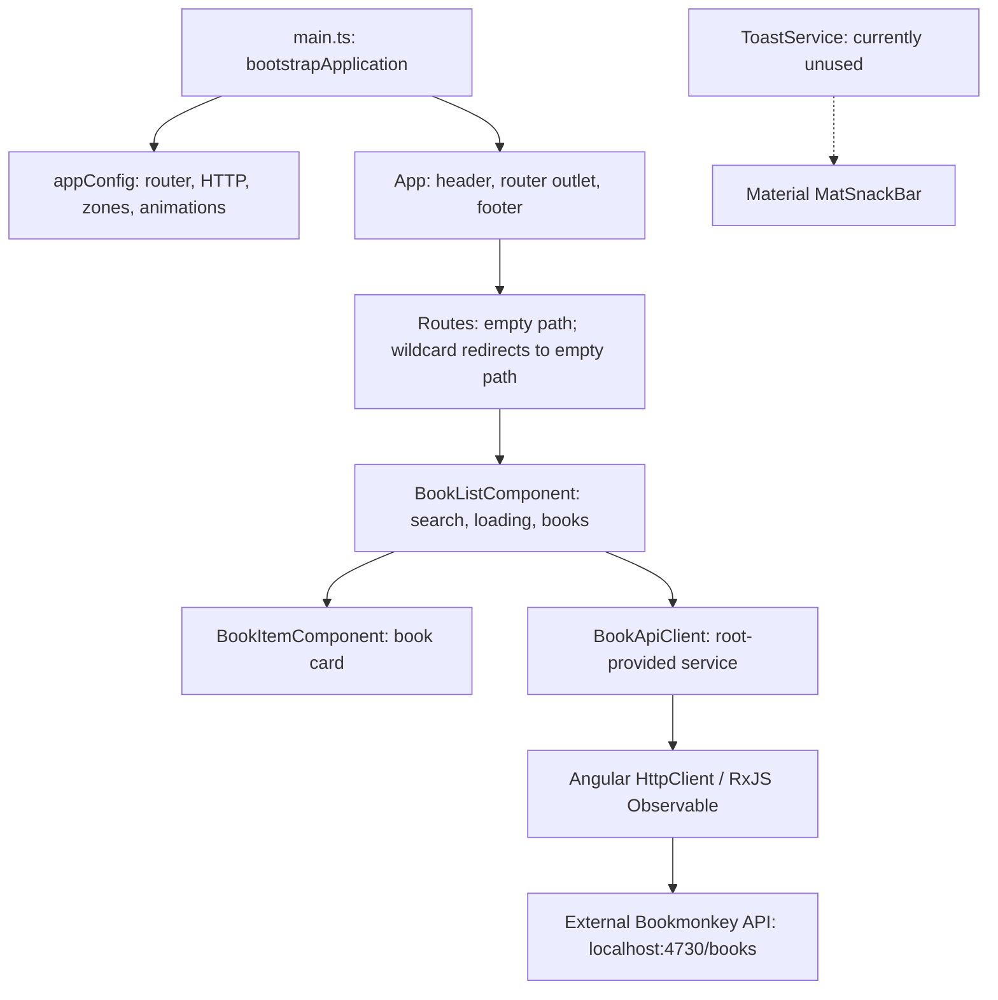

# Architecture

BookMonkey is a small Angular workshop application for browsing and searching books. It is a browser-rendered single-page application with one feature, a separate HTTP API, and state held directly in a component.

This document describes the checked-in implementation, not a proposed target architecture. Findings are verified by source and configuration inspection on 2026-11-09. No application build, browser session, API request, or test suite was run for this documentation change; runtime correctness and API availability remain unverified.

## Application structure

The application uses standalone components and Angular dependency injection; there is no application `NgModule` or central store.

| Area                  | Source                                                                   | Responsibility                                                                                                                     |
| --------------------- | ------------------------------------------------------------------------ | ---------------------------------------------------------------------------------------------------------------------------------- |
| Bootstrap             | [src/main.ts](./src/main.ts)                                             | Starts `App` with `bootstrapApplication`; logs bootstrap failures.                                                                 |
| Application providers | [app.config.ts](./src/app/app.config.ts)                                 | Registers global browser error listeners, zone-based change detection with event coalescing, routing, HTTP, and animations.        |
| Shell                 | [app.ts](./src/app/app.ts), [app.html](./src/app/app.html)               | Renders the shared header/footer and `RouterOutlet`.                                                                               |
| Routing               | [app.routes.ts](./src/app/app.routes.ts)                                 | Eagerly imports the book list for `/`; redirects unmatched paths to the list. No lazy routes, guards, or resolvers are configured. |
| Feature/controller    | [book-list.component.ts](./src/app/books/book-list.component.ts)         | Owns loading/search/result state, triggers requests, and renders book cards and empty/loading states.                              |
| Presentation          | [book-item.component.ts](./src/app/books/book-item.component.ts)         | Receives a `Book` input and displays its cover, title, optional subtitle, author, and ISBN. Makes no API calls.                    |
| API adapter           | [book-api-client.service.ts](./src/app/books/book-api-client.service.ts) | Encapsulates the API URL and query parameters; returns `Observable<Book[]>`.                                                       |
| Data contract         | [book.ts](./src/app/books/book.ts)                                       | Defines the TypeScript interface shared by the API client and components.                                                          |
| Shared utility        | [toast.service.ts](./src/app/shared/toast.service.ts)                    | Wraps Material snack bars with a default 3-second duration. No current application code calls this service.                        |

The feature folder groups its UI, model, and API adapter together. The dependency direction is shell/router → feature component → API adapter → external API, with a separate presentation component below the feature component. This separation is visible in the imports; it is not enforced by a separate library or architectural lint rule.

## Data flow and state

1. On initialization, `BookListComponent` calls `getBooks` with a default `pageSize` of 10.
2. `BookApiClient` sends `GET http://localhost:4730/books?_limit=10`. A nonempty search adds the `q` query parameter through `HttpParams`.
3. The component subscribes to the HTTP observable, assigns the returned books, and clears `loading`. Cards receive individual books through `@Input`; `trackById` uses each book's `id` when rendering the list.
4. The search input uses template-driven forms (`ngModel`). Changes schedule a request after 300 ms using `setTimeout`; the next input change clears the previous pending timer.
5. Clearing the search resets the input and immediately reloads the unfiltered list. Failed requests log to the console and clear `loading`; they do not set a separate error state or invoke `ToastService`.

State consists of ordinary component fields (`books`, `loading`, `searchTerm`, and the timeout handle). There is no implemented signal store, query cache, browser persistence, or URL synchronization. `_limit` restricts the requested result count; no page navigation or offset is implemented.

The [Book interface](./src/app/books/book.ts) includes `id`, `isbn`, `title`, optional `subtitle`, `author`, `publisher`, `numPages`, `price`, `cover`, `abstract`, and `userId`. `price` is a string. The client requests this interface directly, with no DTO mapping or runtime response validation in the application source. The actual API response shape and search semantics were not tested.

## Technology stack and dependencies

The tables cover all direct dependencies in [package.json](./package.json). Versions are the declared constraints; exact resolutions are recorded in [package-lock.json](./package-lock.json). A package's presence in the manifest does not imply that the current application uses its features.

### Application dependencies

| Package(s)                                                                           | Declared version | Role in this repository                                                                                                                                    |
| ------------------------------------------------------------------------------------ | ---------------- | ---------------------------------------------------------------------------------------------------------------------------------------------------------- |
| `@angular/core`, `@angular/common`, `@angular/compiler`, `@angular/platform-browser` | `20.2.1` each    | Angular components, dependency injection, common template directives, compilation support, browser bootstrap, and HTTP support via `@angular/common/http`. |
| `@angular/router`                                                                    | `20.2.1`         | Single-view routing and the shell's router outlet.                                                                                                         |
| `@angular/forms`                                                                     | `20.2.1`         | Template-driven search input through `FormsModule` and `ngModel`.                                                                                          |
| `@angular/animations`                                                                | `20.2.1`         | Animation support is enabled by `provideAnimations`.                                                                                                       |
| `@angular/material`                                                                  | `^20.2.0`        | Used by the currently uncalled snack-bar service and global snack-bar Sass overrides; locked to `20.2.0` in the inspected lockfile.                        |
| `@angular/cdk`                                                                       | `20.2.0`         | Declared UI infrastructure dependency alongside Material; no direct CDK imports in application source.                                                     |
| `rxjs`                                                                               | `7.8.0`          | Observable return type for HTTP requests; components subscribe directly. No RxJS search pipeline is implemented.                                           |
| `zone.js`                                                                            | `0.15.0`         | Configured browser polyfill, paired with zone-based change detection.                                                                                      |
| `tslib`                                                                              | `2.3.0`          | TypeScript runtime helper dependency; `importHelpers` is enabled in the TypeScript configuration.                                                          |
| `@ngrx/signals`                                                                      | `20.0.1`         | Declared but not imported or configured in application source.                                                                                             |
| `@angular-architects/ngrx-toolkit`                                                   | `^20.1.0`        | Declared but not imported or configured; inspected lockfile resolves `20.1.0`.                                                                             |
| `@tanstack/angular-query-experimental`                                               | `^5.85.5`        | Declared but no query provider or queries are configured; inspected lockfile resolves `5.85.5`.                                                            |
| `@angular/platform-server`, `@angular/ssr`                                           | `20.2.1` each    | Declared, but there is no server bootstrap, server build entry, hydration provider, or SSR configuration.                                                  |
| `express`                                                                            | `5.1.0`          | Declared, but no Express server is implemented in this repository. It is not the implementation of the separately launched Bookmonkey API here.            |

### Development dependencies

| Package(s)                            | Declared version | Role in this repository                                                                                                            |
| ------------------------------------- | ---------------- | ---------------------------------------------------------------------------------------------------------------------------------- |
| `typescript`                          | `5.9.2`          | Strict TypeScript compilation targeting ES2022 with module preservation. Angular strict template and injection checks are enabled. |
| `@angular/cli`, `@angular/build`      | `20.2.0` each    | CLI, application builds, development server, and configured test builder.                                                          |
| `@angular/compiler-cli`               | `20.2.1`         | Angular compilation tooling.                                                                                                       |
| `tailwindcss`, `@tailwindcss/postcss` | `4.1.12` each    | Utility styling, imported by the global stylesheet and processed through PostCSS.                                                  |
| `postcss`                             | `8.5.6`          | CSS processing configured in [.postcssrc.json](./.postcssrc.json).                                                                 |
| `@playwright/test`                    | `^1.55.0`        | Browser-test tooling; inspected lockfile resolves `1.55.0`. Existing tests are external-site examples.                             |
| `prettier`                            | `3.6.2`          | Formatting governed by [.prettierrc](./.prettierrc). The package formatting script targets source files only.                      |
| `@types/node`                         | `^20.17.19`      | Node type definitions; inspected lockfile resolves `20.19.11`. This is not a declared Node runtime requirement.                    |
| `@types/express`                      | `^5.0.1`         | Express type definitions; inspected lockfile resolves `5.0.3`. No application server source currently uses them.                   |

No Node engine constraint or package-manager version is declared in the package manifest. Compatibility with a particular runtime was not tested for this summary.

## Styling and browser resources

Most visual styling is implemented with Tailwind utility classes in component templates. [src/styles.css](./src/styles.css) imports Tailwind, and [src/material-theme.scss](./src/material-theme.scss) adds a Material snack-bar color override. Both are global build styles in [angular.json](./angular.json); the shell's own [app.css](./src/app/app.css) is empty.

[src/index.html](./src/index.html) links to Google-hosted Roboto and Material Icons stylesheets. Book cover images use URLs supplied in API data. These introduce browser-side resource requests beyond the app and API. Files in [public](./public) are copied as build assets.

## External API and deployment boundary

The [README](./README.md) documents `npx bookmonkey-api` as a separately launched fake-data API on port 4730. It is not declared as a dependency of this project, and its implementation and persistence are outside this repository. `npm start` starts the Angular development server only.

The API URL is hard-coded in [BookApiClient](./src/app/books/book-api-client.service.ts). No environment-specific endpoint configuration, development proxy, authentication, or HTTP interceptors are configured in the inspected app. When served from the configured local frontend URL (`http://localhost:4200`), requests to port 4730 cross origins. Whether the API permits those requests was not verified.

Architectural implication: deployment beyond the workshop environment requires an API address reachable from the user's browser; `localhost` in the current code refers to that user's machine. The existing repository provides a browser build configuration, not a configured production API or server deployment.

## Build and testing

[angular.json](./angular.json) defines one application project, `angular-workshop-modern`, using `@angular/build:application` with [src/main.ts](./src/main.ts) as its browser entry. Production is the default build configuration, with output hashing and budgets of 500 kB warning / 1 MB error for the initial bundle and 4 kB warning / 8 kB error for individual component styles. Development disables optimization and enables source maps.

| Command                | Configured purpose and limits                                                                                                                                                                                                                                                                |
| ---------------------- | -------------------------------------------------------------------------------------------------------------------------------------------------------------------------------------------------------------------------------------------------------------------------------------------- |
| `npm install`          | Installs project dependencies.                                                                                                                                                                                                                                                               |
| `npm start`            | Runs `ng serve` with the development configuration.                                                                                                                                                                                                                                          |
| `npx bookmonkey-api`   | Launches the external fake-data API according to the README; its package version is not pinned here.                                                                                                                                                                                         |
| `npm run build`        | Runs the default production Angular build.                                                                                                                                                                                                                                                   |
| `npm run watch`        | Rebuilds with the development configuration as files change.                                                                                                                                                                                                                                 |
| `npm test`             | Runs `ng test`; the configured builder is `@angular/build:karma`. No `src/**/*.spec.ts` files exist, and Karma/Jasmine packages are not declared as direct dependencies, although [tsconfig.spec.json](./tsconfig.spec.json) requests Jasmine types. Test execution readiness is unverified. |
| `npx playwright test`  | Uses [playwright.config.ts](./playwright.config.ts), starts/reuses the Angular dev server, and configures Chromium, Firefox, and WebKit projects. The configured [tests](./tests) visit `playwright.dev`, not BookMonkey.                                                                    |
| `npm run format.write` | Formats supported files under `src`; it does not include root Markdown documentation.                                                                                                                                                                                                        |

The additional [tests-examples](./tests-examples) directory contains an external TodoMVC example and is outside Playwright's configured `testDir`. Neither set provides evidence that book loading, searching, or error handling works. No lint script or CI workflow is present in the inspected repository files.

## Architectural constraints and extension points

The following are source-derived implications, not reproduced runtime defects:

- **Concurrent searches:** the debounce clears pending timers but does not cancel in-flight requests or reject stale responses. An older response could replace newer search results. `clearSearch` also does not clear an already pending search timer.
- **Error presentation:** failures only reach the console; the UI has no distinct error state and may retain earlier results. The existing toast utility is not connected to this flow.
- **Lifecycle handling:** the component has no destruction hook to clear its timeout or explicitly cancel requests.
- **State ownership:** local fields keep this single-feature app simple. Shared state or request caching would require an explicit design choice; the declared NgRx and TanStack packages do not provide it automatically.
- **Feature growth:** further routes can be added in [app.routes.ts](./src/app/app.routes.ts), API operations belong in [BookApiClient](./src/app/books/book-api-client.service.ts), and book display changes belong in [BookItemComponent](./src/app/books/book-item.component.ts). Lazy loading, a store, or SSR would be additional architecture work.

## Verification status

- **Verified by inspection:** component/service boundaries, routing, providers, state/request code, direct dependency constraints and lockfile resolutions, build/style configuration, and the scope of existing example tests. Source links above provide the evidence.
- **Not runtime-verified:** compilation, browser rendering, test execution, API availability, response contracts, search behavior, and cross-origin access.
- **Inferred:** the implications and possible request-ordering issues described above follow from source control flow; they were not reproduced in a browser.
- **Unknown from this repository:** the external API's internal architecture/persistence and the intended production hosting environment.
